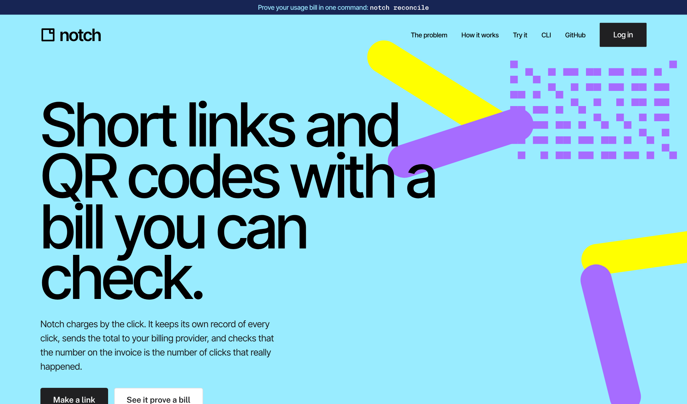
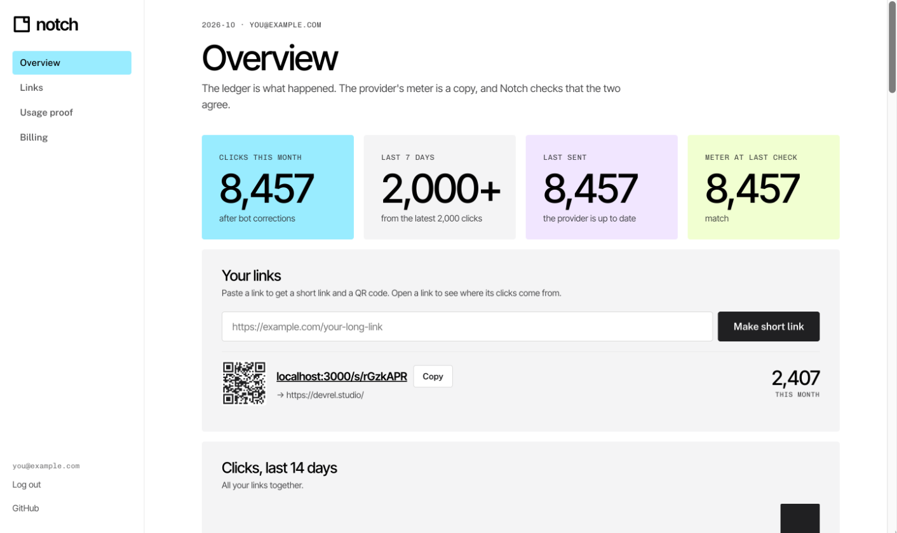
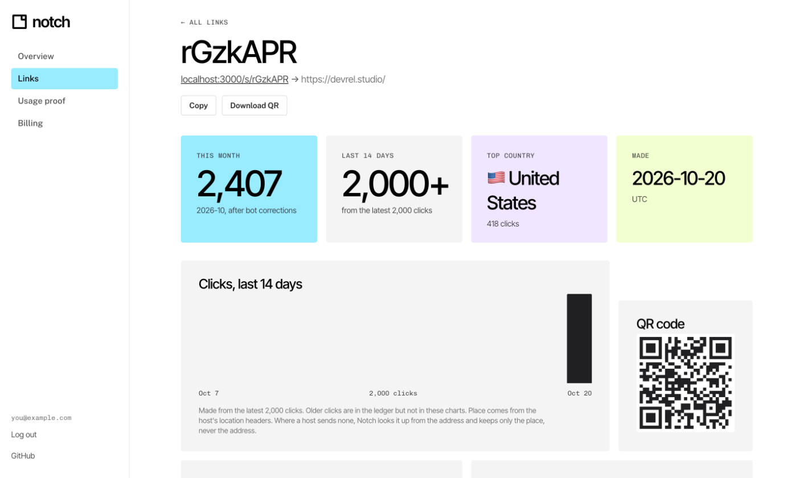
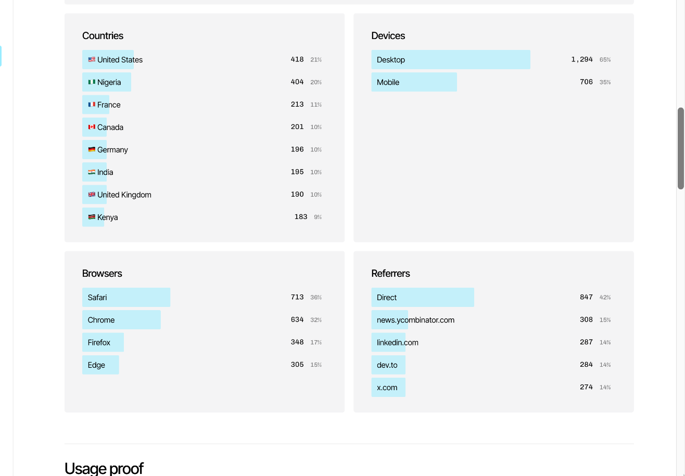
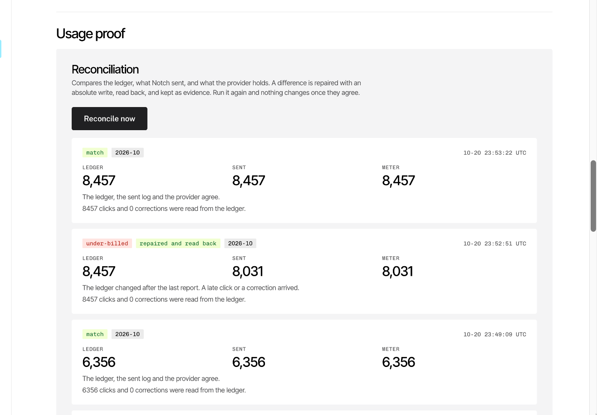
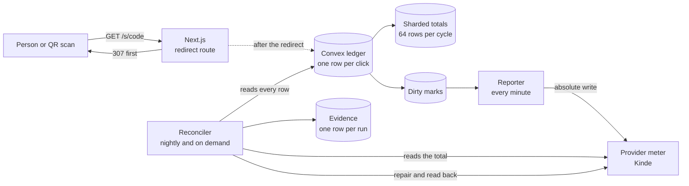
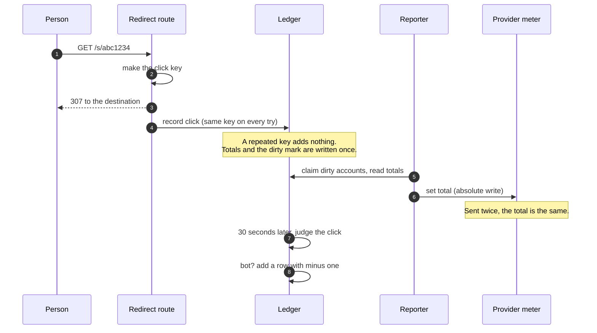
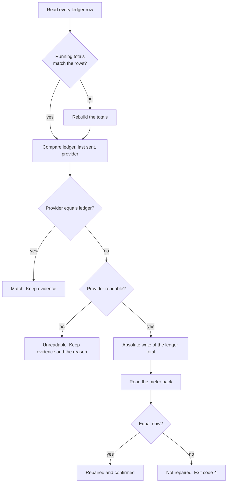

<p align="center">
  
</p>

<h1 align="center">Notch</h1>

<p align="center">
  Short links and QR codes with a bill you can check.<br>
  Every click goes in a ledger once. A nightly check proves the invoice matches it.
</p>

<p align="center">
  <a href="LICENSE"></a>
  
  
  
  
</p>



## What Notch is

Notch makes short links and QR codes, and charges by the click. Each click is one unit of metered usage. Notch keeps its own record of every click, sends the total to a billing provider, and checks that the number on the invoice is the number of clicks that happened.

It is built to show one production problem: **how to prove that the usage you bill matches what happened**, when usage can arrive late, twice, or never.

Notch is a Next.js app (App Router) with a Convex backend. Kinde provides sign-in and the metered billing feature. A command line tool uses the same API as the website.

## The problem

A customer opens an invoice that says 1,204 clicks, and you cannot prove it. Usage billing goes wrong in four ways:

1. A report is sent again after a timeout, and the provider counts it twice.
2. A report fails after the click was recorded, and the provider never hears of it.
3. A click is judged a bot after it was reported, and the meter still holds it.
4. A click arrives after the billing cycle has closed.

## Features

- **A ledger that counts once.** Every click is one row with a key made before the first write. The same key offered twice adds nothing.
- **Corrections, not edits.** A bot click is undone by a new row with minus one. The first row stays, so you can see what happened and why the total changed.
- **Safe reports.** Once a minute, Notch sets the provider's meter to the ledger total with an absolute write. A total sent twice leaves the same total.
- **A nightly reconciler.** It compares the ledger, what Notch sent, and what the provider holds. It repairs a difference, reads the meter back, and keeps the evidence. Running it again changes nothing.
- **A dashboard.** Clicks this month, a 14-day chart, and country, region, city, device, browser, system and referrer breakdowns. Each link has its own page.
- **Link settings.** Rename a link, change where it goes, turn it off, or delete it. A deleted link stops working, and its clicks stay in the ledger.
- **QR codes.** Download a QR code for any link as an SVG.
- **A command line tool.** Make links, run the reconciler, and read the result as JSON.
- **Privacy by default.** Notch keeps the place of a click and a salted hash of the address. It never keeps the address.

## The dashboard



Each link has its own page, with a chart, a QR code and where its clicks come from.



| Where clicks come from | The proof |
| --- | --- |
|  |  |

The data in these screenshots comes from `scripts/load.mjs`, which sends clicks with varied places, devices and referrers. The reconciliation on the right found the meter 426 clicks behind the ledger, repaired it, and then matched at 8,457.

## Architecture



There are three parts.

1. **The ledger** (`convex/ledger.ts`, `convex/lib/post.ts`). It writes each click, keeps running totals, and marks the account for the next report.
2. **The reporter** (`convex/recon.ts`, `convex/crons.ts`). It sends the ledger total to the provider and marks failed cycles again.
3. **The reconciler** (`convex/recon.ts`). It proves the totals against the ledger, compares the three numbers, repairs, reads back and stores evidence.

### How a click is counted



### How the reconciler decides



## Decisions and the reasons for them

**The ledger is the record. The provider's meter is a copy.** A meter you cannot read back is a number you have to trust. Notch decides what happened from its own rows, and uses the provider only to bill.

**The meter is written with an absolute write, never a delta.** A delta adds to the total, so a retry after a timeout counts twice. An absolute write sets the total, so the same call twice leaves the same total. This was checked against a real Kinde account.

**There is no retry schedule.** A failed cycle is marked again, and the next minute sends the newest total. The newest total is always the right one, so there is nothing to queue or replay.

**A click key is made before the first write.** The redirect route makes the key, sends the person on, and then writes the click. Every try carries the same key, so a retry cannot count a click twice.

**The redirect never waits for the database.** The write happens after the response. A slow or busy database cannot slow a person who is following a link.

**A correction is a new row.** A bot is judged 30 seconds after the click, because that is when there is enough to judge. The original row stays and a row with minus one is added to the cycle of the click it undoes.

**Totals are sharded.** Each account and cycle has 64 total rows, and each click adds to a random one. A load test with one hot link first lost clicks to write conflicts on a single counter row. With 64 rows and five jittered tries, none were lost.

**A cycle is marked once.** A busy account does not write the dirty mark for each click. Many clicks in a minute become one report.

**The reconciler reads the whole ledger and the totals are only a cache.** It reads every row, in pages of 1,000, and rebuilds the running totals if they are wrong. A bug in the fast path cannot hide behind the fast path.

**A fresh match is recorded even after a repair.** The evidence compares only to the latest row for the cycle. A match that follows a repair is a new fact, so it is stored.

**Evidence is a row per run, not a log line.** Each row holds the three numbers, the verdict, the cause and a hash. Running the reconciler twice on the same data stores one row, not two.

**Closed cycles go to review, not to the meter.** Notch does not write to a cycle that has ended. It records the difference and leaves it for a person to decide.

**The cycle is the UTC calendar month.** Kinde does not return cycle dates, so this is an assumption. It is listed under "What is verified and what is not".

**Delete keeps the history.** A deleted link leaves the lists and answers "not found". Its clicks and ledger lines stay, because they were billed and the reconciler needs them to match the meter.

**Place is looked up, and only the place is kept.** On Vercel, the place comes from the platform's headers. Where there are none (your own machine), Notch looks it up after the redirect and keeps the country, region and city. A salted hash of the address groups clicks, and the address is never stored.

**Charts read a sample.** They read the latest 2,000 clicks, so a page view stays cheap. The page says when it is capped. The bill is computed from the ledger, not from the charts.

**Tests call the real functions.** The whole loop runs against Convex's test backend, so the tests need no deployment.

## Run it on your machine

You need Node.js 22 or later and a Convex account.

```bash
git clone https://github.com/sholajegede/notch.git
cd notch
npm install
npx convex dev        # first terminal: creates a deployment and writes NEXT_PUBLIC_CONVEX_URL
npm run setup         # makes a server key and stores it in .env.local and on Convex
npm run dev           # the site on http://localhost:3000
```

With no Kinde settings, Notch uses a local account and a built-in stand-in for the provider's meter, so the whole loop runs with no billing account. Open the dashboard, make a link, open it, then use **Break it on purpose** and **Reconcile now**.

## Configuration

| Variable | Where | Purpose |
| --- | --- | --- |
| `NEXT_PUBLIC_CONVEX_URL` | Web app | Address of the Convex deployment. `npx convex dev` writes it |
| `NEXT_PUBLIC_SITE_URL` | Web app | Public address, used in short links and QR codes |
| `NOTCH_SERVER_KEY` | Web app and Convex | A long random string. The web app proves itself to Convex with it. `npm run setup` sets both |
| `KINDE_CLIENT_ID`, `KINDE_CLIENT_SECRET`, `KINDE_ISSUER_URL` | Web app | Sign-in. Leave empty to use the local account |
| `KINDE_SITE_URL`, `KINDE_POST_LOGIN_REDIRECT_URL`, `KINDE_POST_LOGOUT_REDIRECT_URL` | Web app | Where Kinde sends people after sign-in and sign-out |
| `KINDE_DEVICE_CLIENT_ID` | Web app | A "Device and IoT" application. The CLI signs in with it |
| `METER_DRIVER` | Web app and Convex | Set to `kinde` to report to Kinde. Empty uses the built-in meter |
| `KINDE_DOMAIN`, `KINDE_M2M_CLIENT_ID`, `KINDE_M2M_CLIENT_SECRET` | Convex | A machine-to-machine app that writes and reads the meter |

`.env.example` lists them all.

## Command line

```bash
npm run notch -- login
npm run notch -- shorten https://example.com/menu
npm run notch -- drift            # built-in meter only: count 6 extra
npm run notch -- reconcile        # prove, repair, read back
npm run notch -- reconcile        # the second run changes nothing
```

Every command has `--json`. `notch reconcile` exits with 4 when it leaves a difference it could not fix.

## Report to Kinde

On the Convex deployment:

```bash
npx convex env set METER_DRIVER kinde
npx convex env set KINDE_DOMAIN https://yourdomain.kinde.com
npx convex env set KINDE_M2M_CLIENT_ID <your machine-to-machine client id>
npx convex env set KINDE_M2M_CLIENT_SECRET <your machine-to-machine client secret>
```

The machine-to-machine app needs the `create:meter_usage` and `read:meter_usage` scopes. Set `METER_DRIVER=kinde` in `.env.local` too. Then, in the dashboard, connect the customer's Kinde agreement id and the feature code.

### What is verified and what is not

Checked against a real Kinde account:

- `POST /api/v1/billing/meter_usage` with `meter_type_code: "absolute"` sets the running total, and sending it again leaves the same total.
- A `delta` write adds to the total, so a retried delta counts twice.
- `GET /api/v1/billing/meter_usage` needs the `read:meter_usage` scope and the feature code. It returns `current_usage` for the current cycle. Add `all_cycles=true` to see other cycles.
- Each write is stored as its own record. After more than 1,200 extra records, the read still returned the right total.
- A write dated in a past month is accepted. It is stored as its own record and does not change the current total.
- About 1,200 writes at roughly 180 a second all returned 200. Kinde did not answer 429.

Not verified yet, and written here as assumptions:

- How a billing cycle is bounded. The response has no dates, and Notch uses the calendar month in UTC.
- What Kinde sends when it does rate limit, because it never did in testing.
- Whether a write for a past month changes an invoice. The first invoice on the test agreement is not due yet.

## Built for load

Everything that grows with clicks is kept small, so no job has to read or write a lot at once:

- **Running totals are sharded.** A read adds 64 small rows. The same goes for each link.
- **The reporter claims and reads in one transaction.** A click that arrives after the read marks the cycle again, so it is never lost between the read and the send. It sends 100 cycles per batch, 10 at a time, and stops early if Kinde answers 429.
- **Reads are bounded.** The dashboard reads 15 ledger rows and a few total rows. Only the reconciler reads the whole ledger.
- **The nightly reconcile walks in pages.** Each page is 50 accounts, 5 at a time, and schedules the next page.
- **A click is written after the redirect, with up to five tries and a random, growing wait.** The key is made before the first try.
- **Limits.** 1,000 links and 10 new links a minute for each account. A burst of 30 clicks from one address on one link within two minutes is judged a bot and corrected.

One measured run, on a laptop dev server, reporting to a real Kinde account:

| Measure | Result |
| --- | --- |
| Clicks sent | 5,000 at 100 at a time |
| Clicks recorded | 5,000 of 5,000 |
| Speed | about 97 redirects a second |
| Redirect time | median 455 ms, 95th percentile 916 ms, 99th percentile 1,633 ms |
| Reconcile afterwards | match at 6,048 in the ledger, the sent log and the meter, with 0 corrections |

The reconciler proves the copy, not the capture. A click that never reached the ledger is invisible to it, so the load run counts what was sent against what was recorded.

To measure your own deployment:

```bash
node scripts/load.mjs <short code> --clicks 5000 --concurrency 100
```

It prints requests a second and redirect times, and sends varied places, devices and referrers so the charts fill in. Run `npm run notch -- reconcile` after it.

## Tests

```bash
npm test          # the rules, and the whole loop against Convex's test backend
npm run typecheck
npm run lint
```

| File | What it checks |
| --- | --- |
| `tests/core.test.ts` | Cycles, keys, bot rules, the decision table for the reconciler |
| `tests/flow.test.ts` | The whole loop: clicks, corrections, reports, repair, read back, link settings and delete |
| `tests/analytics.test.ts` | The summaries, the agent parser and the place headers |
| `tests/place.test.ts` | The place lookup and the private-address check |

## Deploy

1. Create a production Convex deployment, set `NOTCH_SERVER_KEY` on it, and run `npx convex deploy`.
2. Deploy the Next.js app to Vercel or any Node host. Set the variables from the table above, with `NEXT_PUBLIC_CONVEX_URL` set to the production address and `NEXT_PUBLIC_SITE_URL` set to your domain.
3. Add the Kinde variables, create a "Device and IoT" application for the CLI, and a machine-to-machine app for the meter.
4. Set `METER_DRIVER=kinde` on both sides and connect an agreement in the dashboard.

On Vercel and Cloudflare, the place of a click comes from the platform's headers. On other hosts, Notch looks it up from the address after the redirect.

## Project layout

| Path | Contents |
| --- | --- |
| `convex/` | Schema and functions: links, ledger, totals, reporter, reconciler, analytics, scheduled jobs |
| `convex/lib/` | The rules: cycles, keys, bot judging, totals, the meter drivers |
| `src/app/` | Pages, the redirect route `/s/[code]`, QR codes and the API under `/api/v1` |
| `src/components/` | The dashboard, charts and controls |
| `src/lib/` | Click parsing, place lookup, formatting, auth |
| `cli/` | The command line tool |
| `scripts/` | Setup and the load test |
| `tests/` | Rules, loop, analytics and place tests |

## Limits

- Notch bills one feature, clicks, for one agreement per account.
- The cycle is the UTC calendar month. A provider with other cycle dates needs a change in `convex/lib/core.ts`.
- Only the current cycle can be read back from Kinde. An earlier cycle is proved from the ledger alone.
- The charts read the latest 2,000 clicks of a link or an account. Older clicks stay in the ledger.
- Reconciliation proves the meter against the ledger. It cannot see a click that never reached the ledger.
- A bot is judged by a simple rule (a burst from one address, or a known bot agent). It is not a bot-detection service.
- Notch does not review links. Add link review before you open sign-up to the public, because short links are used for phishing.
- The place lookup uses a free public service. A busy public instance should use a paid one or a host that sends headers.

## Contributing

Bug reports and pull requests are welcome. [CONTRIBUTING.md](CONTRIBUTING.md) explains how to set up, what the checks are, and what a good change looks like.

To report a security problem, follow [SECURITY.md](SECURITY.md) and do not open a public issue.

## Licence

[MIT](LICENSE). Built by [Shola Jegede](https://sholajegede.com).
